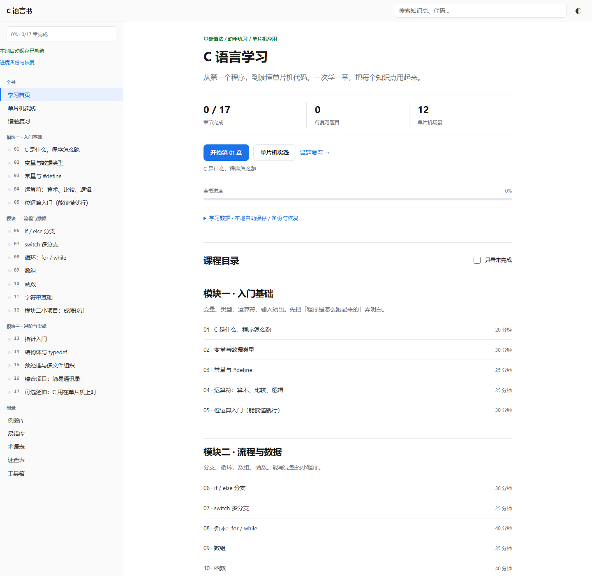
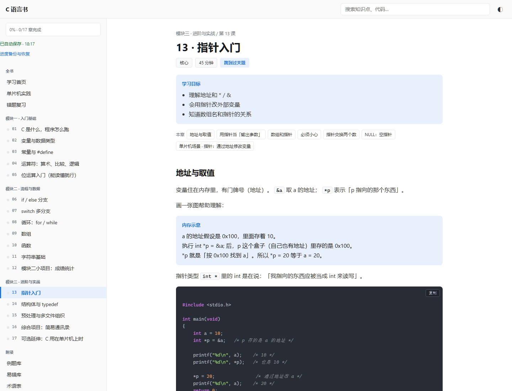

# C-Learning · 从第一个程序到单片机

一套写给零基础学习者的 **C 语言自学书**：17 章主线课程、5 个附录、12 个单片机场景，
纯静态页面，离线可用，学习进度保存在本机浏览器里。

[](https://github.com/2048sensei/C-Learning/actions/workflows/pages.yml)
[](https://github.com/2048sensei/C-Learning/actions/workflows/verify.yml)
[](学习资源/release-info.json)
[](LICENSE)

**在线学习：<https://2048sensei.github.io/C-Learning/>**



## 这是什么

不是又一份语法清单，而是一条能走完的路线：

- **一条主线**：从 `Hello, World!` 出发，经变量、分支、循环、数组、函数、字符串，
  到指针、结构体、多文件工程，最后做一个通讯录小项目。
- **每章都能动手**：可复制运行的完整代码、常见错误对照、章末小测与讲解。
- **面向硬件但不绑硬件**：每个模块配“单片机场景”，讲同样的语法在 8051 风格代码里长什么样，
  以及哪些地方不能照搬（寄存器语义、`while(1)`、中断、资源限制）。
- **不装环境**：不需要 Node、Python、数据库或后台服务，打开 HTML 就能学。

## 内容地图

| 模块 | 章节 | 主题 |
| --- | --- | --- |
| 模块一 · 入门基础 | 01–05 | C 是什么、变量与类型、常量与宏、运算符、位运算 |
| 模块二 · 流程与数据 | 06–12 | 分支、switch、循环、数组、函数、字符串、成绩统计小项目 |
| 模块三 · 进阶与实战 | 13–17 | 指针、结构体、预处理与多文件、通讯录项目、单片机延伸 |
| 附录 | 6 篇 | 例题库、易错库、术语表、速查表、工具箱、单片机实践（12 个场景） |
| 复习 | 1 页 | 错题复习，按测验结果自动收集 |



## 快速开始

### 方式一：在线（推荐）

打开 <https://2048sensei.github.io/C-Learning/>，无需安装。

### 方式二：便携版（Windows）

1. 在仓库根目录双击 **`开始学习.exe`**；
2. 启动器用系统自带 .NET Framework 打开默认浏览器，然后立即退出，不装软件、不联网；
3. 若系统没有配置 HTML 默认打开程序，或启动器被安全软件拦截，直接双击 `学习资源/index.html`。

> 启动器是本地编译的小程序，未做数字签名，不建议为运行它关闭系统安全防护。
> 发布 ZIP 时请保持 `开始学习.exe` 与 `学习资源/` 同级，启动器靠这个相对位置找页面。

### 方式三：本地静态服务器

```powershell
# 任选一种，二选一即可
npx --yes serve 学习资源
# 或
python -m http.server 8000 --directory 学习资源
```

## 目录结构

```text
C-Learning/
├─ 开始学习.exe              # Windows 便携启动器（.NET，未签名）
├─ 学习资源/                 # 站点根目录，也是 GitHub Pages 的发布内容
│  ├─ index.html             # 学习首页 / 目录 / 进度与备份
│  ├─ review.html            # 错题复习
│  ├─ chapters/              # 01–17 章
│  ├─ appendix-*.html        # 例题、易错、术语、速查、工具箱、单片机实践
│  ├─ assets/favicon.svg
│  ├─ book.css / book.js
│  ├─ js/                    # 学习状态、备份、搜索索引
│  ├─ release-info.json      # 版本、构建时间、每个文件的 SHA-256
│  └─ 使用说明.txt            # 学习记录、备份恢复、验收细节
├─ scripts/                  # 校验脚本（清单哈希、内部链接）
├─ assets/                   # 仅供 README 使用的截图
└─ .github/                  # Pages 部署、CI、Issue / PR 模板
```

## 学习记录与备份

- 章节完成、最近学习、测验与错题、实践记录自动存进**当前浏览器的 localStorage**，不上传；
- 侧边栏会显示保存状态，写入失败会明确提示，不会假装已保存；
- 首页“学习数据”里可以**导出 JSON 备份**，导入时支持合并或覆盖，并会先显示记录数量；
- 换电脑、换浏览器、移动文件夹或清理浏览器数据前，请先导出备份。

细节见 [`学习资源/使用说明.txt`](学习资源/使用说明.txt)。

## 校验与维护

站点文件与 `release-info.json` 里的 SHA-256 一一对应，CI 每次提交都会核对：

```powershell
# 34 个文件的路径与哈希、便携包顶层结构
pwsh ./scripts/verify-release.ps1

# 页面之间的相对链接是否都能打开
node ./scripts/check-links.mjs
```

修改了 `学习资源/` 里的内容后，需要同步刷新清单：

```powershell
pwsh ./scripts/update-release-info.ps1 -Version 1.1.1
```

> 站点页面是构建产物，打包脚本不在本仓库；`release-info.json` 是它的完整性清单，
> 不是数字签名。

## 参与贡献

欢迎提 Issue 指出错别字、讲不清的概念、跑不通的示例；提 PR 前请先读
[CONTRIBUTING.md](CONTRIBUTING.md)，尤其是“改动站点文件后重算清单哈希”这一条。

## 许可

[MIT](LICENSE) © 2026 2048sensei
